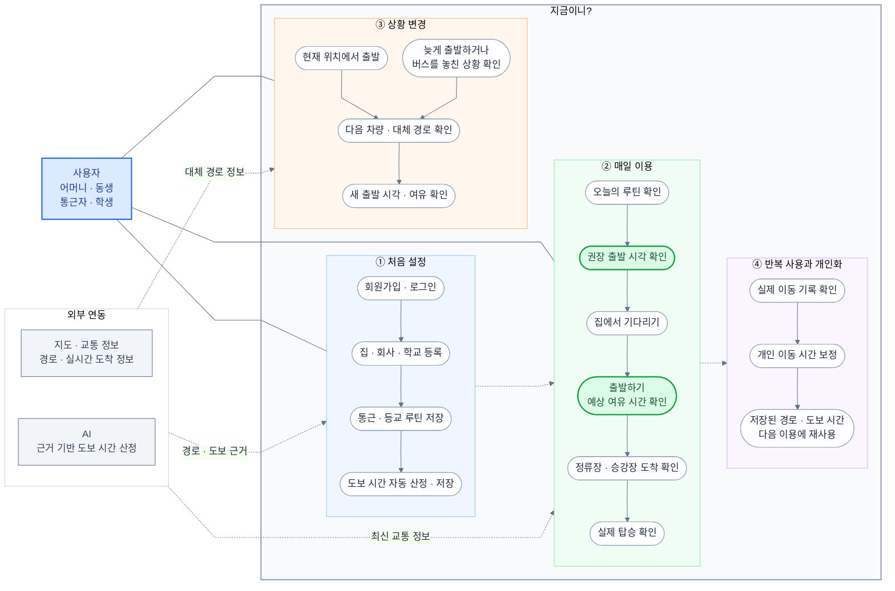

# 지금이니?

집에서 기다리다가, 대중교통을 놓치지 않을 만큼 여유 있게 출발하도록 돕는 개인화 통근·등교 서비스.

- 프론트엔드: React
- 백엔드: Python FastAPI
- 프로젝트 루트: `C:/projects/timeisnow`. 기획 문서도 이 폴더에서 관리합니다.
- 이 README는 기획 소개이며 기능 구현 완료를 의미하지 않습니다.
- 작성일: 2026-10-01

## 시작한 이유

동생이나 어머니가 집을 나설 때 버스를 밖에서 오래 기다리는 경험을 줄이고 싶었습니다. 출발 시간을 맞추려고 휴대전화로 버스 도착 정보를 계속 확인하지만, 가끔은 늦게 출발해 버스를 놓치기도 했습니다.

‘지금이니?’는 언제 집에서 나가면 되는지를 바로 알려주는 것을 목표로 합니다. 통근·등교처럼 반복되는 이동을 루틴으로 저장하면 같은 장소와 경로의 도보 시간을 다시 계산할 필요가 줄어듭니다. 저장된 경로와 도보 시간은 재사용하고, 달라지는 버스·지하철 도착 정보는 새로 확인합니다.

## 핵심 기능

- 회원가입과 사용자별 장소·루틴 저장.
- 집·회사·학교 또는 현재 위치에서 출발.
- 버스·지하철과 환승 경로 확인.
- 실제 보행 경로 데이터를 근거로 AI가 도보 시간을 산정하고 저장.
- 초기 첫 탑승 여유 5분을 반영한 출발 안내.
- 출발·정류장 또는 승강장 도착·탑승 기록을 분리해 개인 이동 시간을 보정.
- AI 산정 결과와 실제 이동을 비교하는 품질 이력 및 실행 로그.

안내 예시:

> **3분 뒤 출발하세요.**  
> 그때 출발하면 정류장 도착 후 **약 5분의 여유가 있어요.**  
> 예상 도보 5분 · 버스 약 13분 후 도착

화면을 닫아도 받는 백그라운드 출발 알림의 첫 출시 포함 여부는 아직 미정입니다.

## 유스 케이스와 이용 흐름

아래는 Mermaid flowchart로 표현한 유스 케이스·이용 흐름입니다. 엄격한 UML 유스 케이스 표기보다는 사용자의 행동과 기능 연결을 함께 보여줍니다.

사용자는 왼쪽, 기능은 그룹 안에서 세로로 배치하도록 구성했습니다. 그룹 안의 실선 화살표는 이용 흐름, 그룹 사이 점선은 기능 연계, 사용자와 그룹의 실선은 이용 관계를 뜻합니다. 외부 연동의 점선은 정보 제공 관계이며 모든 화면에서 AI를 호출한다는 뜻은 아닙니다.

### draw.io에서 사용하기

1. 위 코드 블록 안의 내용만 복사합니다. 코드 블록을 감싸는 백틱은 제외합니다.
2. draw.io의 Mermaid 삽입 창에 붙여넣습니다.
3. Image 선택 옵션이 있다면 SVG 이미지로 삽입할 수 있습니다.

렌더러와 버전에 따라 간격·글꼴·배치는 달라질 수 있습니다. 이 README 추가 작업에서는 draw.io에서 다시 렌더링해 검증하지 않았습니다.

## 프론트엔드 화면 구성 초안

| 화면 | 핵심 역할 |
| --- | --- |
| 홈 | 오늘의 루틴, 출발까지 남은 시간, 예상 여유 |
| 루틴 등록·수정 | 출발·도착 장소, 요일, 목표 시각, 경로 선택 |
| 이동 중 | 탑승·환승 안내, 도착·탑승 확인 |
| 내 장소·설정 | 장소 관리, 여유 설정, 개인화 상태, 계정 |

회원가입·로그인과 첫 장소 등록은 초기 이용 흐름으로 별도 제공합니다.

## 문서 안내

| 문서 | 내용 |
| --- | --- |
| [기획서](./planning.md) | 요구사항, MVP 범위, 시스템 구성 |
| [기능별 개발 작업](./feature_breakdown.md) | 작업 분리, 선행 조건, 완료 기준 |
| [개인화 알고리즘](./personalization.md) | 실제 접근 시간 관측과 개인 보정 |
| [AI 프롬프트](./ai_prompts.md) | 입력·출력 계약과 AI 검증 기준 |
| [로깅 계획](./logging.md) | 요청 추적, 오류, 품질 이력 |
| [개발 일지](./development_log.md) | 변경 이유, 검증 결과, 배운 내용 |
| [Notion API 명세서](https://app.notion.com/p/3ebace1670c6806c8199cde33ebfbdfa) | API 계약의 기준 문서 |

## 개발 규칙

이 프로젝트의 [AGENTS.md](./AGENTS.md)를 따릅니다. 기획 문서와 README는 같은 프로젝트 폴더에서 관리합니다.

- 개발 전 최신 Notion API 명세와 관련 로컬 문서를 확인합니다.
- 기획·API 계약이 바뀌면 Notion과 관련 문서를 함께 갱신합니다.
- 작은 기능 단위로 구현하고 실행 로그와 실제 결과를 확인합니다.
- 실행하지 않은 테스트나 미구현 기능을 완료로 기록하지 않습니다.

