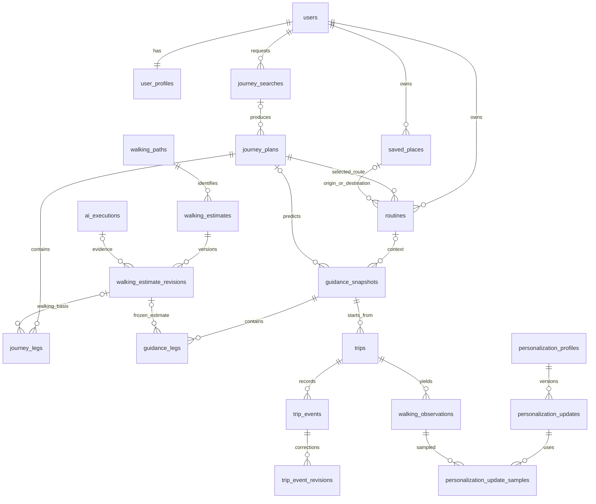
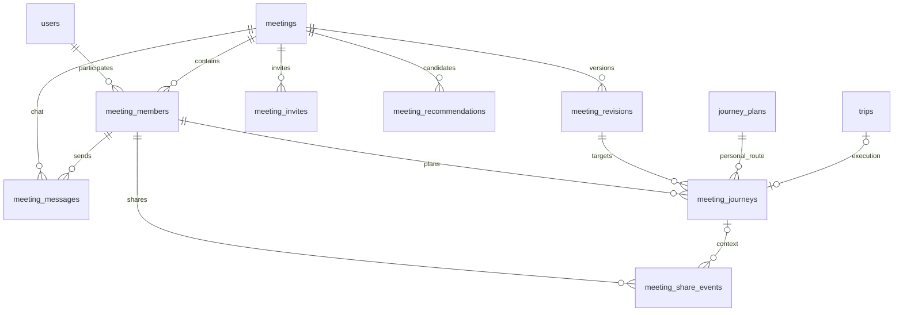

# 지금이니? — 테이블·연관관계 설계 초안

F04-01(2026-10-07, Notion v0.40): 카카오 대중교통 후보 조회 POST /journey-searches202·본인 GET 결과 및 /jobs 상태를 구현했다. depart_now부터 지원하며 arrive_by는 명시적으로 준비 중 오류다. 후보는 provider_estimate/insufficient_data, 도착 시각 null이고 AI 도보·실시간·역 내부/출입구·중간 지역 검증은 후속이다. 입력 GPS/지도 좌표·원본 geometry는 DB/로그에 저장하지 않는다. 검색300초·작업/멱등24시간·재시작60초 실패 처리, 저장 장소 존재/위치 버전 재검사. 상세 [journey_api.md](./journey_api.md). F03-05a는 main8b4b40b에 병합됐으며 GPS 수치 정책 보류를 유지한다. 실제 추가 테이블은0006_journey_searches의journey_searches/journey_search_keys이며 users ON DELETE CASCADE, 멱등 search 참조는ON DELETE SET NULL이다.

- 버전: 0.3 / 작성일: 2026-10-02
- 상태: **회원 인증5개 테이블은0002_member_auth로 적용**, 나머지 이동/장소/약속 DDL은 설계 제안·미적용.
- 기준: [API 명세](https://app.notion.com/p/3ebace1670c6806c8199cde33ebfbdfa), [기획](./planning.md), [개인화](./personalization.md), [약속 확장](./meeting_plan.md).
- DB: PostgreSQL 17 / 로컬 Docker. 실행은 [database.md](./database.md).
- 표는 핵심 컬럼·관계의 논리 설계다. 최종 컬럼 길이·상태값·전체 DDL은 기능별 마이그레이션 전에 확정한다. 인증·약속 API 등 미정 계약을 이번 설계로 확정하지 않는다.

## 1. 설계에서 가장 중요한 구분

1. **재사용 경로**: 집에서 정류장까지의 경로와 기준 시간. 차량의 오늘 도착 시각을 여기에 영구 저장하지 않는다.
2. **출발 안내 스냅샷**: 특정 시각에 사용자에게 보여준 예측과 사용한 산정 버전. 이후 학습 결과로 과거 값을 덮어쓰지 않는다.
3. **실제 이동**: 출발·정류장 도착·탑승 이벤트. 출발 버튼은 본인 신고이며 자동 검증이 아니다.
4. **개인화**: 실제 접근 시간을 기준 시간과 비교한 계수 및 표본 이력. 탑승 전 대기는 보행 학습에 합치지 않는다.
5. **공동 약속 / 개인 여정**: 약속 장소·시각은 공유하지만 각 참여자의 출발지·경로·이동 기록은 개인 소유다.

PK는 한 행의 고유 ID, FK는 다른 테이블의 행을 연결하는 ID다. 회원 한 명이 장소 여러 개를 저장하면 1:N 관계다. 회원 여러 명이 약속 여러 개에 참여하면 중간 테이블 meeting_members가 있는 N:M 관계다.

## 2. 공통 저장 규칙

- 기본 PK는 uuid, 이름은 snake_case. 연결 테이블은 복합 PK 사용 가능. API에서는 기존대로 불투명 문자열 ID로 제공한다.
- 절대 시각은 timestamptz, 서버·DB 세션은 UTC 사용. 루틴의 반복 시간은 time + IANA timezone을 별도 보관한다. timestamptz만으로 사용자가 선택한 시간대 이름이 보존된다고 가정하지 않는다.
- 시간 길이는 integer 초, 거리는 integer 미터, 좌표는 numeric(9,6), 계수는 numeric(8,4)를 제안한다. 반올림 정책은 개인화 문서와 맞춘다.
- created_at은 기본 now(). 변경 가능한 행에는 updated_at 및 version integer 기본 1, CHECK(version > 0). expected_version은 요청 조건이지 별도 영구 컬럼이 아니다.
- 필수 컬럼은 NOT NULL. 아래 표의 ?는 NULL 허용이다. NULL은 미확인·미설정이고 0과 구분한다.
- 설정 여유·소요 시간은 음수 금지. **계산 결과 slack_seconds는 음수가 가능**하다. AI 실패·정보 부족 결과에는 확정된 시간을 억지로 넣지 않는다.
- 핵심 FK·소유권·정렬·조회 컬럼은 정규 컬럼으로 둔다. 공급자 근거·당시 응답 요약·가변 구조만 jsonb를 사용하고 스키마 버전을 함께 기록한다.
- 개인 자원에는 user_id FK. 하위 테이블에도 소유자를 둘 경우 부모의 UNIQUE(user_id,id)와 복합 FK로 다른 사용자의 데이터를 연결하지 못하게 한다. 서버 인증/인가 검증도 필수다.
- 보관은 실행 로그14일·개인 이동/품질90일·공동 약속/채팅 종결후30일로 확정(policy_decisions.md). 장소/루틴/프로필은 사용자 삭제까지 유지, 캐시/결과는 별도TTL. 매일 청소/삭제 사본/백업 정리는 아직 미구현.
- 외부 역·정류장·노선 ID는 provider와 함께 저장한다. 외부 ID를 서비스 회원 ID처럼 FK로 취급하지 않는다. 전국 교통 마스터 DB·PostGIS 도입은 현재 필수가 아니다.

## 3. 통근 MVP ER 다이어그램

읽기 위한 핵심 관계도이며 반복되는 user_id와 일부 품질 연결은 생략했다. ||는 하나, o|는 0 또는 하나, o{는 0개 이상이다.

routine → journey_plan은 반복 사용할 경로를 고르는 관계다. guidance → journey_plan은 그날 계산에 사용한 경로다. 같은 경로여도 매번 안내는 새 교통 근거를 사용한다.

### A. 회원과 고정 장소

F03-03 적용(2026-10-07): 0005_place_management에서 location_version을 기존version으로 초기화, 위치/출입구/출처 변경에만 증가한다. label 변경은 일반version만 증가. 향후 walking_paths origin_version/destination_version에는 장소location_version을 연결한다. 장소 삭제는 물리 삭제, place_creation_keys FK는ON DELETE SET NULL로24시간 삭제 표시만 유지해 동일 저장 키 재생성을 막는다. 삭제/동시성/소유권 및 기존 장소 버전 보존·마이그레이션 왕복 검증. 미구현 실제 루틴 FK NULL/needs_attention과 산정 재사용 차단은 각 기능에서 구현한다.

F03-02 적용(2026-10-07): 0004_place_map_pin이 saved_places에 entrance_note(사용자 입력, null/1~100자), location_source(search/map_pin), location_address(null/법정동 명칭)를 추가하고 place_location_confirmations(본인 좌표/법정동 명칭/600초)을 생성한다. 기존 장소 기본값 search/null/null 유지 및0003↔0004 왕복에서 데이터 보존 검증. PATCH는 본인 행 잠금/expected_version, 좌표 확인 ID/기한/일치 검사 후 좌표·설명·출처가 바뀌면 version 증가. 도보/경로 캐시 테이블은 아직 생성하지 않으며 향후 place_id/version 불일치로 재사용 제외한다.

F03-01 적용(2026-10-07): 0003_saved_places로 saved_places(name/address/좌표/라벨/버전 포함), place_searches(본인 최소 후보 jsonb/10분 만료), place_creation_keys(본인 저장 요청 해시/장소 참조/24시간)를 실제 생성했다. 검색어/공급자 원본은 저장하지 않는다. name/address는 선택 결과 표시용 최소 데이터, entrance_ref는 이번 API에서 null만 허용. 기능별 소유권/만료/멱등·임시 스키마 왕복 검증 완료, 수정/삭제·루틴 FK·산정 무효화는 미구현이다.

| 테이블 | 역할 / 핵심 컬럼 | 관계·제약 |
| --- | --- | --- |
| users | id, display_name, status, created_at, updated_at, version | 서비스 내부 회원 ID. 삭제 진행 중 접근 차단. 비밀번호 컬럼을 먼저 만들지 않음 |
| user_profiles | user_id(PK/FK), walking_preference, first_boarding_buffer_seconds=300, transfer_buffer_seconds, route_preference, timezone, version | users와 1:1. 여유 정수0~1800초, 첫 탑승 기본300초·환승 기본120초 확정. 학습 계수는 여기서 수동 수정하지 않음 |
| saved_places | id, user_id, label, name, address, latitude, longitude, entrance_ref?, entrance_note?, location_source, location_address?, version, location_version, created_at, updated_at | users 1:N. 좌표 범위 CHECK. 일반version은 수정 충돌, location_version은 위치 계산. 집·회사 라벨을 고정 enum으로 제한하지 않음 |

D01 변경(2026-10-06): 이메일 중복 확인·비밀번호 로그인, 메일 인증/복구 후순위. users/auth_credentials/user_profiles/auth_sessions/auth_rate_limit_buckets를 적용했다. auth_credentials는 user_id·email_normalized UNIQUE·password_hash, auth_sessions는 token_hash PK·user_id nullable·csrf_token_hash·절대/미사용 만료, rate_limit_buckets는 scope/key_hash/window_start 복합PK·count/expires_at다. 인증 관련 메일 토큰/outbox는 만들지 않는다. 실제 DDL은0002_member_auth가 기준이며 UUID 세션 참조·WS 연결은 해당 후속 기능에서 추가한다.

### B. 경로 검색과 루틴

| 테이블 | 역할 / 핵심 컬럼 | 관계·제약 |
| --- | --- | --- |
| journey_searches | id, user_id, job_id, origin_snapshot jsonb, destination_snapshot jsonb, timing jsonb, preferences jsonb, status, expires_at | 현재 위치는 임시 검색 근거. 모두 saved_places에 강제 등록하지 않음 |
| journey_plans | id, user_id, search_id?, purpose, origin_snapshot, destination_snapshot, total_seconds?, transfer_count, calculated_at, valid_until? | 검색 후보 및 선택 경로. search_id는 검색 만료 정리 시 분리 가능. 선택된 경로는 루틴이 참조하는 동안 유지 |
| journey_legs | id, user_id, journey_plan_id, sequence, mode, from_snapshot, to_snapshot, provider?, route_ref?, direction?, duration_seconds?, time_source, walking_estimate_revision_id? | UNIQUE(journey_plan_id,sequence), sequence>=0. 정류장·출입구·플랫폼 구분. 도보 없는 구간은 산정 FK NULL |
| routines | id, user_id, name, origin_place_id?, destination_place_id?, journey_plan_id, weekdays smallint[], target_arrival_local_time?, timezone, status, version | 장소와 경로 모두 본인 것. 요일 1~7 중복 없이 1개 이상. 장소 FK는 정상 상태에서 필수, 삭제 시 NULL + needs_attention |

검색 후보의 candidate_id는 journey_plans.id에 매핑한다. 저장 요청에서는 search_id와 candidate_id의 조합·소유권·유효기간을 확인한다. 루틴 저장 시 경로 구조와 방향은 유지하되 검색 당시 차량 도착 시각을 다음 출발의 근거로 사용하지 않는다. 경로 변경은 새 plan을 만들며 이미 사용된 plan/leg를 덮어쓰지 않는다.

F06-01 적용(2026-10-07, 0007_routines): journey_plans를 id, user_id, search_id, candidate_id, candidate jsonb, total_seconds, transfer_count, model_version, created_at으로 우선 만들었다. candidate는 검색 후보를 journey.v1으로 보강한 전체 스냅샷이며 좌표 등 위치값은 넣지 않고 요약 API만 응답한다. UNIQUE(user_id,search_id,candidate_id)로 같은 후보 재저장 시 스냅샷을 재사용한다. purpose·origin_snapshot/destination_snapshot·valid_until과 journey_legs 분해는 후속(AI 도보·출발 안내)에서 확정한다. routines는 id, user_id, name, origin_place_id, destination_place_id, journey_plan_id, status(active|needs_attention), version, created_at, updated_at이며 name은 1~30자 공백제거 CHECK, 장소 FK ON DELETE SET NULL, plan FK ON DELETE CASCADE다. routine_creation_keys(user_id+key PK, body_hash, routine_id FK ON DELETE SET NULL, expires_at)로 24시간 멱등을 보장하며 루틴 삭제 후 동일 키 재시도는 404로 막는다. 장소 삭제 시 참조 루틴의 해당 FK를 NULL로 하고 status=needs_attention, version+1로 바꾼다.

F06-02 적용(2026-10-07, 0008_routine_schedule): routines에 weekdays smallint[] NOT NULL DEFAULT '{1,2,3,4,5}'(CHECK cardinality 1~7, 값 1~7), target_arrival_local_time time NULL, timezone text NOT NULL DEFAULT 'Asia/Seoul'(CHECK =Asia/Seoul)을 추가했다. weekdays는 ISO 1(월)~7(일)이고 저장 API가 중복 없는 1~7개를 검증하며, 목표 도착은 HH:mm 형식만 받는다. 기존 루틴은 기본값(월~금, 목표 없음)으로 채워진다.

### C. AI 도보 산정·재사용

| 테이블 | 역할 / 핵심 컬럼 | 관계·제약 |
| --- | --- | --- |
| walking_paths | id, user_id, path_key, origin_place_id?, destination_place_id?, origin_version?, destination_version?, endpoint_snapshot, provider, provider_path_ref?, path_version, direction, scope, distance_meters, unpersonalized_base_seconds, evidence jsonb, calculated_at, expires_at | 기준 경로의 불변 버전. 기준 초 >0. 장소·출입구·방향·접근 유형·공급자 경로 버전을 path_key에 반영. 새 근거는 새 행 |
| walking_estimates | id, user_id, walking_path_id, policy_version, created_at | 사용자별 산정 자원. UNIQUE(user_id,walking_path_id,policy_version). API estimate_id의 대상 |
| walking_estimate_revisions | id, user_id, estimate_id, revision_no, personalization_update_id?, ai_execution_id?, parent_revision_id?, base_seconds, applied_duration_factor, estimated_seconds, source, calculated_at, expires_at | UNIQUE(estimate_id,revision_no). 불변 기록. base_seconds>0, estimated_seconds>=0, factor>0. 기본 계수일 때 update FK NULL 및 1.0 |
| ai_executions | id, user_id, task_type, model_version, prompt_version, policy_version, input_evidence jsonb, structured_result jsonb?, validation_status, failure_code?, latency_ms, usage jsonb, created_at | 검증 실패도 저장하되 서비스용 산정 revision을 만들지 않음. 개인 원문·키·내부 사고 과정 제외 |

도보 구간을 안내에 사용할 때 최신 유효 revision을 선택해 ID를 고정한다. latest를 가리키는 순환 FK는 초기 설계에서 두지 않고 revision_no로 조회한다. profile_recalculation은 부모 산정과 기존 근거를 재사용하고 AI 실행 FK를 새로 만들지 않는다. AI 결과를 중복 복사하지 않는다.

### D. 안내·실제 이동·관측

| 테이블 | 역할 / 핵심 컬럼 | 관계·제약 |
| --- | --- | --- |
| guidance_snapshots | id, user_id, routine_id?, journey_plan_id?, status, departure_basis, selected_departure_at?, recommended_departure_at?, estimated_arrival_at?, buffer_seconds, slack_seconds?, traffic_fetched_at?, valid_until, calculation_policy_version, context_snapshot jsonb, created_at | 안내 응답의 guidance_id. 불변 기록. 정보 부족이면 plan·예측 NULL 가능. 루틴 삭제 시 routine_id NULL, 당시 맥락은 유지 |
| guidance_legs | id, user_id, guidance_id, journey_leg_id, walking_estimate_revision_id?, estimated_boarding_at?, estimated_alighting_at?, approach_seconds?, transfer_buffer_seconds?, slack_seconds?, feasibility, time_source, traffic_evidence jsonb | UNIQUE(guidance_id,journey_leg_id). 부모 안내와 같은 plan 소속 leg인지 트랜잭션에서 검증. 당시 공급자 시각·조회 시각 포함 |
| trips | id, user_id, initial_guidance_id, measurement_mode, status, outcome?, started_at?, ended_at?, version | 초기 guidance는 동일 사용자. 세션 생성 자체는 실제 출발이 아님. 시작은 departed 이벤트로 판단 |
| trip_guidances | trip_id, guidance_id, linked_at | 복합 PK. 이동 중 재안내도 이력으로 연결. 생성 시 초기 안내도 연결. 동일 사용자 검증 |
| trip_events | id, user_id, trip_id, guidance_leg_id, client_event_id, type, source, occurred_at, received_at, excluded, note_code?, version | UNIQUE(trip_id,client_event_id). leg는 해당 trip에 연결된 안내 소속인지 검증. 현재 유효 이벤트 값 저장 |
| trip_event_revisions | id, event_id, revision_no, occurred_at, excluded, correction_reason?, recorded_at | UNIQUE(event_id,revision_no). 최초 입력도 revision 1로 보존. 이후 정정은 새 행 및 trip_events 현재값 갱신을 한 트랜잭션으로 처리 |
| walking_observations | id, user_id, trip_id, guidance_leg_id, walking_estimate_revision_id, start_event_revision_id?, ready_event_revision_id?, board_event_revision_id?, observation_version, observed_seconds?, wait_seconds?, valid_for_learning, exclusion_reason?, created_at | UNIQUE(trip_id,guidance_leg_id,observation_version). 정확한 이벤트 revision과 당시 예측에 연결. 정정 후 새 관측 버전 생성 |

guidance_leg_id는 DB 내부 연결이다. 기존 API leg_id에는 journey_legs.id를 유지하고 서버가 trip의 안내 이력에서 유일한 해당 구간을 찾는다. 같은 leg의 재안내는 새 구간으로 오인하지 않는다. 다른 경로로 변경하면 새 journey_leg ID를 사용한다. 모호한 요청은 계약의 이벤트 검증 오류로 거절하며 API 필드를 몰래 추가하지 않는다.

정상 접근 시간 = ready - start, 대기 = board - ready. start와 board만 있으면 observed_seconds=NULL 및 학습 제외. 음수 시간·지연 입력은 기록을 조작해 맞추지 않고 제외 이유를 저장한다. 이벤트 순서/구간 간 일치는 한 행 CHECK로 해결하지 않고 잠금·트랜잭션 검증으로 처리한다.

교통 조회 전체를 보관하는 독립 arrival_snapshots 테이블은 초기에는 만들지 않는다. 안내별 최소 근거를 guidance_legs.traffic_evidence에 저장하고 중복·조회량이 커질 때 별도 테이블로 분리한다. 카운트다운 매초 DB 기록도 하지 않는다.

### E. 개인화와 품질

| 테이블 | 역할 / 핵심 컬럼 | 관계·제약 |
| --- | --- | --- |
| personalization_profiles | id, user_id, scope_type, scope_key, learning_generation, reset_at?, version | UNIQUE(user_id,scope_type,scope_key). scope_key는 구간 path_key 또는 접근 유형 키이며 NULL 대신 명시적 값 사용 |
| personalization_updates | id, profile_id, generation, revision_no, previous_update_id?, trigger_key, reason, old_factor, new_factor, sample_count, algorithm_version, created_at | UNIQUE(profile_id,revision_no), UNIQUE(profile_id,generation,trigger_key). 초기화·정정 재계산도 reason으로 구분. 현재 정책 factor 0.5~2.0 |
| personalization_update_samples | update_id, observation_id | 복합 PK. 어떤 관측 버전을 사용했는지 추적. 동일 관측은 최근 20개 창에 여러 번 포함 가능하나 같은 새 관측으로 갱신을 두 번 실행하지 않음 |

reset 시 generation 증가 및 기본 계수 기록. reset 이전에 측정한 관측은 늦게 수신돼도 다시 학습하지 않는다. 정상 학습은 이전 예측과 실제 결과를 평가한 후 수행하며 개인화된 estimated_seconds가 아닌 base_seconds를 분모로 쓴다.

별도의 개인별 신뢰 점수 테이블은 만들지 않는다. 품질 MAE·대기시간·과소예측 비율은 관측과 당시 안내를 조회·집계한다. 성능 문제가 확인되기 전 별도 통계 테이블을 원본처럼 관리하지 않는다.

### F. 공통 처리 기반

| 테이블 | 역할 / 핵심 컬럼 | 관계·제약 |
| --- | --- | --- |
| jobs | id, user_id?, type, status, progress?, result_ref?, error_code?, created_at, started_at?, finished_at?, expires_at?, deletion_receipt_hash? | 비동기 검색·재산정·삭제·내보내기. 결과에 원문 비밀 금지. 계정 삭제 후 조회는 auth_api.md의 X-Deletion-Receipt 계약 적용 |
| idempotency_requests | id, user_id, method, request_path, key_hash, request_hash, status, response_status?, response_ref?, expires_at | UNIQUE(user_id,method,request_path,key_hash). 경로는 자원 ID를 포함하는 정규 경로(키·좌표 쿼리 제외). 동시 실행은 unique+트랜잭션으로 제어 |

멱등 키는 같은 버튼 재전송으로 루틴·이벤트가 두 번 생성되지 않게 한다. 같은 키에 다른 본문은 기존 409 계약을 따른다. 응답 재현에 필요한 최소 결과만 권한 있는 DB에 보관하고 실행 로그에 복제하지 않는다. 만료 키 청소와 계정/기록 삭제 시 연결된 응답 캐시 정리도 포함한다. 24시간 보관은 D03 위임 결정으로 확정했다.

## 4. 약속 확장 ER 다이어그램

아래는 후속 설계 제안이다. 루틴 기반 API에 meeting_id를 바로 추가하는 변경이 아니다.

구현 상태(2026-10-14): meetings·meeting_members·meeting_revisions·meeting_invites는 migration 0013으로 생성됐다. 멱등 처리는 meeting_idempotency_keys(user_id, scope, idempotency_key, body_hash, meeting_id NULL 허용, expires_at)로, 비동기 작업은 jobs(id, user_id, type='meeting_delete', status, error, result_ref, finished_at, expires_at)로 별도 두었다. meeting_recommendations·meeting_messages·meeting_journeys·meeting_share_events·realtime 계열은 아직 생성 전이다.

| 테이블 | 역할 / 핵심 컬럼 | 관계·제약 |
| --- | --- | --- |
| meetings | id, organizer_user_id, title, status, version, created_at | 공동 약속. 혼자 가는 일정도 구성 가능. 생성자도 member로 추가 |
| meeting_members | id, meeting_id, user_id, role, participation_status, sharing_enabled=false, joined_at?, left_at?, version | UNIQUE(meeting_id,user_id). 출발지/집 주소는 공동 조회 필드에 넣지 않음 |
| meeting_revisions | id, meeting_id, revision_no, target_arrival_at, timezone, destination_snapshot, confirmed_by_member_id, confirmed_at | UNIQUE(meeting_id,revision_no). 확정된 장소·시각의 불변 버전. 미확정 중에는 행을 만들지 않음 |
| meeting_invites | id, meeting_id, inviter_member_id, token_hash, expires_at, accepted_by_user_id?, accepted_at?, revoked_at? | token_hash UNIQUE. 원본 초대 토큰 저장/로그 금지. 활성1개/약속·24시간·1회 수락, 재발급은 기존 활성 토큰 철회. D05 확정 |
| meeting_recommendations | id, meeting_id, request_version, input_fingerprint, candidates jsonb, algorithm_version, ai_execution_id?, expires_at | 두 사람의 이동 근거·순위·후보 시각. 추천 설명용 AI 실행은 개인 원문을 공유하지 않음. 확정 장소는 별도로 revision에 저장 |
| meeting_journeys | id, member_id, meeting_revision_id, journey_plan_id, trip_id?, status, created_at | 해당 참여자의 개인 경로. trip_id UNIQUE(비NULL). 재계산·재출발 때 새 행; 동시에 활성 경로 하나만 허용하는 부분 unique 인덱스 제안 |
| meeting_messages | id, meeting_id, sender_member_id, client_message_id, body, sent_at, deleted_at? | UNIQUE(sender_member_id,client_message_id). 멤버가 같은 약속 소속이고 참여 중인지 검증. 본문1~1000자·본인 삭제·종결후30일 보관 확정, 계정탈퇴는 본인 본문 삭제. meeting_api.md 참고 |
| meeting_share_events | id, meeting_id, member_id, meeting_journey_id?, event_type, source_event_revision_id?, client_event_id, source, occurred_at, received_at, eta?, eta_calculated_at?, expires_at?, payload_version | UNIQUE(member_id,client_event_id). 동의/철회/출발 신고/정정/ETA 변경 기록. 당시 trip 이벤트 revision으로 근거 추적 |

공유 이벤트는 정밀 위치·집 주소·전체 개인 안내 JSON을 복사하지 않는다. 본인 신고는 source=manual로 표시하며 기록 수신을 GPS 검증으로 바꾸지 않는다. 공유 상태는 최신 이벤트로 계산하고 캐시는 권한 검사 후에만 제공한다.

모든 약속 하위 FK는 같은 meeting 소속임을 보장한다. meeting_journeys의 plan·trip 소유자는 member의 user_id와 같아야 한다. 복합 FK로 가능한 부분을 강제하고 나머지는 트랜잭션·테스트로 보완한다.

시간·장소 변경은 새 revision 생성 → 이전 안내/개인 경로 상태를 재계산 필요로 표시 → 참여자별 새 안내 생성 순서다. 이전 이력을 덮어쓰지 않는다. 초대 수락·공유 동의·현재 참여 상태는 별개다. 방 URL을 안다는 것만으로 읽기 권한을 주지 않는다.

친구 목록, 공개 평점, 파일 첨부, 읽음 표시, 상시 GPS 추적은 현재 요구가 아니므로 별도 테이블을 만들지 않는다. 푸시 구독 테이블은 알림 범위 확정 후 설계한다.

## 5. 삭제·정정·권한 정책

| 상황 | 제안 처리 |
| --- | --- |
| 장소 삭제 | 루틴 FK NULL + needs_attention, 해당 경로 캐시 무효화. 과거 안내 최소 스냅샷은 기존 계약대로 유지. 장소 상세 개인정보의 파생 사본 정리 범위는 보관 정책 확정 필요 |
| 루틴 삭제 | 안내의 routine_id는 SET NULL 가능. 과거 출발 맥락은 스냅샷으로 조회. 공유 경로는 다른 참조가 없을 때 정리 |
| 이벤트 정정 | 원본 revision 유지 + 새 revision/관측 생성. 영향을 받은 학습 계수를 재계산하고 새 산정 버전 생성 |
| 이동 삭제 | 비동기 작업으로 관측·표본 연결·공유에 남은 개인 출발 근거·멱등 결과를 함께 정리. 남은 관측으로 계수 재생성 후 완료. 과거 예측을 새 계수로 수정하지 않음 |
| 회원 탈퇴 | 접근 차단 → 개인 스냅샷/AI 근거/캐시/내보내기 포함 삭제 작업 → 완료. 본인 메시지 본문/공유/티켓 삭제, 주최자는 약속 취소·상대 공동30일 열람. D05 확정 meeting_api.md 참고 |
| 약속 취소/공유 철회 | 이후 공유 및 조회 차단, 상대 화면에 취소/철회 반영. 미출발·불성실로 해석하지 않음 |
| 만료 데이터 | 참조 중인 산정·안내를 단순 TTL CASCADE로 삭제하지 않음. 참조·보관 정책에 맞춰 종속 정리 및 필요 최소 스냅샷 유지 여부 결정 |

CASCADE는 부모와 수명이 같은 자식(예: 삭제 대상 이벤트의 정정 이력)에만 사용한다. 불변 이력 FK는 일반 변경 중 RESTRICT를 기본 제안으로 하고 개인정보 삭제 작업에서는 의존 관계를 순서대로 정리한다. 단순 deleted_at만 남기는 것은 개인정보 삭제 완료가 아니다.

## 6. 조회용 인덱스·트랜잭션

- 개인 목록: saved_places/routines/trips의 (user_id,created_at DESC,id DESC).
- 순서: journey_legs(journey_plan_id,sequence), trip_events(trip_id,occurred_at,id).
- 최신값: walking_estimate_revisions(estimate_id,revision_no DESC), personalization_updates(profile_id,revision_no DESC).
- 관측 학습: walking_observations(user_id,created_at DESC), 필요한 구간/유효성 조건을 실제 쿼리에 맞춰 추가.
- 채팅: meeting_messages(meeting_id,sent_at,id), 공유: meeting_share_events(member_id,received_at,id).
- 작업/만료 청소: jobs(status,created_at), idempotency_requests(expires_at). 개인정보 JSON 전체에 일괄 GIN 인덱스를 먼저 만들지 않는다.
- FK 대상에는 PK/UNIQUE, 자식 FK 검색용 인덱스는 삭제·조회 패턴에 맞춰 별도 설계한다.
- optimistic lock: UPDATE ... WHERE id=? AND user_id=? AND version=expected_version. 수정 행 0개일 때 소유권을 노출하지 않도록 없음/버전 충돌을 구분한다.
- 이벤트 저장+revision+관측 무효화, 약속 확정+버전 변경, 채팅 저장은 각각 원자적으로 처리한다. WebSocket 방송은 commit 성공 후 수행하고 재접속 시 DB 이력으로 복구한다.

다른 행/테이블의 상태를 일반 CHECK에 넣지 않는다. 교차 관계는 FK·UNIQUE 또는 트랜잭션 검증을 사용한다. 참고: [PostgreSQL 제약조건](https://www.postgresql.org/docs/17/ddl-constraints.html), [날짜·시간 자료형](https://www.postgresql.org/docs/17/datatype-datetime.html).

## 7. API와 데이터 연결

| 기존 API 묶음 | 주 저장 테이블 |
| --- | --- |
| /me, /me/profile | users, user_profiles (auth_api.md의 인증 테이블 연결) |
| /places | saved_places |
| /journey-searches | jobs, journey_searches, journey_plans, journey_legs |
| /walking-estimates | walking_paths, walking_estimates, walking_estimate_revisions, ai_executions |
| /routines | routines 및 선택한 journey_plan |
| /guidance-queries | guidance_snapshots, guidance_legs |
| /trips 및 /events | trips, trip_guidances, trip_events, trip_event_revisions, walking_observations |
| /me/personalization, /quality-summary | personalization_profiles/updates/update_samples 및 관측·안내 집계 |
| /jobs, /trip-exports | jobs, 만료되는 비공개 내보내기 결과 참조 |
| 약속·채팅·출발 공유 | meeting_api.md의 상세 REST/WS 초안. 기존 routine_id 필수 계약은 유지하며 약속 전용 안내 경로 신설 |

초기 planning.md의 User/Profile/TripFeedback/ArrivalSnapshot 등은 개념 모델이었다. 실제 테이블 제안은 이 문서로 구체화한다. 프로필 계수는 personalization 계열, TripFeedback은 trips/events/observations, ArrivalSnapshot은 guidance_legs의 근거로 매핑한다.

## 8. 실제 생성 순서와 검증 계획

모든 테이블을 한 번에 만들지 않고 사용하는 기능과 함께 추가한다.

1. F00-05b: 마이그레이션 도구·적용/복구 절차 준비. Alembic 기반 및 빈 0001_baseline 적용 완료(2026-10-02). 업무 테이블 DDL은 미적용. [실행 안내](./migrations.md).
2. 회원·장소: 인증 결정 후 users → user_profiles → saved_places. 인증 관련 테이블은 선택한 방식만 추가.
3. 검색·도보: jobs/멱등 처리 → journey_searches → walking_paths, ai_executions → walking_estimates/revisions → journey_plans/legs → routines. 학습 update FK는 개인화 단계에서 추가.
4. 안내·이동: guidance_snapshots/legs → trips/trip_guidances → trip_events/revisions → walking_observations.
5. 개인화: personalization_profiles/updates/update_samples 추가, 산정 revision과 계수 연결. 리셋·삭제 재계산 검증.
6. 약속 확장: 약속 API·권한·삭제 정책 결정 후 meetings/members → revisions/invites/recommendations → journeys/messages/share_events. 개인 안내의 약속 연결은 그때 계약과 함께 확장.

마이그레이션 후 검증할 항목:

- [ ] 타인 장소/경로/산정 ID를 연결하면 거절된다.
- [ ] 동일 이벤트·채팅·멱등 키 재전송과 동시 요청이 중복 행을 만들지 않는다.
- [ ] 루틴·장소 변경 후 과거 안내 예측이 바뀌지 않는다.
- [ ] 출발+탑승만 있는 관측은 학습되지 않고 정정 후 재계산이 한 번만 수행된다.
- [ ] 리셋 전 관측은 재전송·지연 수신돼도 다시 학습되지 않는다.
- [ ] 삭제 후 FK가 깨지지 않고 개인화·캐시·스냅샷 등 파생 개인 데이터도 정리된다.
- [ ] 약속의 비참여자는 채팅·출발 상태를 읽지 못하며 철회 즉시 조회가 막힌다.
- [ ] 테스트 DB에서 마이그레이션 적용·필요한 복구 및 Docker 볼륨 유지가 검증된다.

이번 완료 범위는 설계 문서·관계도·API 대응·생성 순서 작성이다. 실제 FK·인덱스·쿼리 성능·Mermaid 렌더링은 아직 검증하지 않았다.

## 9. 약속 API 상세화에 따른 추가 설계 — 2026-10-02

[meeting_api.md](./meeting_api.md)가 신규 약속 REST/WS의 세부 기준이다. 기존 표는 논리 관계를 나타내며 아래 컬럼·2개 테이블을 추가 제안한다. 전체 DDL 미적용.

- meetings: max_members=2 확정, last_event_seq(bigint), closed_at?, delete_after?. 이벤트 seq는 행 잠금으로 증가시키고 서버 이벤트 저장과 같은 트랜잭션으로 처리한다.
- meeting_members: private_origin jsonb?, origin_version, recommendation_consent=false, sharing_enabled=false, sharing_expires_at?. private_origin은 본인 조회/서버 계산 전용.
- meeting_recommendations: job_id, target_arrival_at, input_versions jsonb(참여자와 출발지 버전), status, outcome, error_code?. 확정/계산 완료 시 입력 버전 재검증.
- meeting_messages: version, body_hash. 삭제 본문은 NULL, 중복 재전송으로 복구되지 않도록 멱등 캐시도 정리.
- meeting_share_events: version, supersedes_event_id?, excluded=false, correction_reason?. arrivals/arrival-corrections도 본인 원본 이력으로 저장하며 공개 여부는 member 동의로 결정한다.
- guidance_snapshots: meeting_journey_id? FK. routine_id와 동시에 non-NULL 불가. 루틴 삭제 이력이 있으므로 무조건 둘 중 하나 필수로 강제하지 않는다.
- meeting_invites: 원본 토큰은 해시로만 보관. 멱등 발급 응답 캐시는 소비·철회·만료 전까지 암호화해 보관하고 이후 제거한다.
- idempotency_requests: 필요한 초대 응답에 한해 encrypted_response?, response_expires_at?를 검토한다. 원문을 일반 응답 JSON/로그에 보관하지 않는다.

| 테이블 | 주요 컬럼 | 관계·제약 |
| --- | --- | --- |
| meeting_realtime_events | id, meeting_id, seq bigint, type, entity_ref jsonb, occurred_at, expires_at | UNIQUE(meeting_id,seq). 약속 FK. 본문·좌표·ETA 원문 없이 변경된 자원 ID만 저장. 24시간 재생 확정 |
| meeting_realtime_tickets | id, member_id, token_hash, auth_session_ref, expires_at, consumed_at? | token_hash UNIQUE. 30초·1회 사용 확정. 권한/세션 상실 시 차단. 티켓 응답은 멱등 캐시에 저장하지 않음 |

기존 31개 제안에 2개를 더한 33개 논리 테이블 후보다. 최초 ERD는 핵심 관계를 유지하며 events는 meetings 1:N, tickets는 meeting_members 1:N으로 추가된다. D01 결정으로 auth_session_ref는 auth_sessions.id를 참조한다. 인증 후보 4개를 추가한 전체 논리 테이블 후보는 37개이며 실제 생성은 미완료다.

운영 보관/탈퇴/주최자 계정 삭제 처리의 상세 제안은 meeting_api.md 11절을 따른다. 제안 승인 전 해당 데이터 삭제 정책을 확정된 운영 정책으로 배포하지 않는다.

## D03·D05 후속 결정 — 2026-10-06

[policy_decisions.md](./policy_decisions.md)·Notion v0.26 참조. 약속 최대2명·draft 미사용30일 삭제·confirmed 목표시각6시간후 자동종결·종결후 공동30일·개인90일·재전송24시간·공유ETA120초. 주최자 탈퇴/비주최자 탈퇴/메시지 본문 삭제·개인trip 연결해제 규칙은 meeting_api.md 확정 계약을 적용한다. 기존 논리 테이블을 통한 시간/상태/만료 정책이며 신규 DDL/물리 삭제 실행 없음.

### F06-03 루틴 관리 (2026-10-08)
추가 DDL 없이0008을 재사용한다. 본인 목록은created_at DESC,id DESC 키셋 조회, cursor행의created_at을 소유권 확인 후 경계로 사용한다. 수정은routines version을 잠그고 검증한 후보 스냅샷을 연결한다. 루틴 쓰기는회원별 advisory transaction lock과 공유 plan행 잠금으로 직렬화한다. 삭제 및 경로 교체 후 다른 루틴 참조가 없는journey_plans만 삭제하며routine_creation_keys의삭제 표시는FK SET NULL로 유지한다. 실제trip 이력이 생길 때 스냅샷 보존 관계를 확장해야 한다.

## F05-04 실제 적용 스키마 — 2026-10-12

0009_walking_history: walking_paths, walking_estimates, walking_estimate_revisions, ai_executions를 우선 생성한다. C절은 전체 후속 설계이며 이번 실제 필드는 마이그레이션을 기준으로 한다. 최소 후보/근거·장소 위치 버전 참조와 확인/산정/30일 유효/90일 보관을 path에 보존, 숫자/프로필 버전/실행 연결은revision에 보존한다. estimate/path·revision/estimate·revision/execution은 id,user_id 복합FK로 동일 소유자를 강제한다. 같은 실행request_id는 회원별unique이며 동일내용 재요청과 내용충돌을 구분한다. 새 근거/산정은 새 path/estimate/revision(현재revision_no1)을 생성한다. 갱신/개인화 부모 연결은 후속이다.

ai_executions는 최소 입력/Context와 reason을 제외한 안전한 구조화 결과·검증 상태·실패코드·실측 지연/알려진 사용량만 보관한다. model/지연/사용량 미확인은null, 원문/정밀 위치/이름/메모/키/내부사고는 비저장. 회원삭제CASCADE, 장소삭제는 과거JSON 참조를 보존하고 요약조회404로 차단한다. 위치/프로필 버전 변경409,90일 청소 함수 제공·자동 스케줄은 후속이다. 상세 walking_api.md·Notion v0.54.

## F05-05 캐시 확장 — 2026-10-12

0010_walking_cache: walking_paths.cache_key char(64)/cache_identity jsonb는 nullable 쌍이며 미확인 기존 행을 백필하지 않는다. 회원·물리 키·기한 조회 인덱스를 추가한다. ai_executions.reused_estimates jsonb는 NOT NULL·기본[]·배열 제약이다. 최소 재사용 연결은 본인 원본 FK 조회와 검산으로 확인하고 삭제/만료 연결은 재실행을 차단한다. 기존 numeric revision은 수정/복제하지 않는다. 회원 CASCADE·90일 정리 유지. walking_api.md·Notion v0.55.

## F05-06 재계산 revision — 2026-10-13

0011_walking_recalculation: source 제약에 profile_recalculation 추가, parent_revision_id uuid/candidate_id varchar(200) 추가. 부모는(id,user_id,estimate_id) 복합FK로 같은 회원의 같은 산정만 연결하고 삭제CASCADE. AI 원본은부모/candidate_id null, 재계산은둘다필수이며자기자신참조금지. 기존 원본 revision은 보존하고 estimate별 revision_no 증가를 기존 회원/물리 키 잠금 안에서 처리한다. 새 실행과 현재 후보를 연결하지만 최초 AI 근거 버전과 원본 기한은 유지한다. walking_api.md·Notion v0.56.

## 이동·약속 migration 통합 — 2026-10-14

단일 head는0014_integrated_features다. 부모0013_manual_trips와0013_meeting_core는 기존 ID/0012 부모를 보존하며 no-op merge revision으로 연결한다. 어느0013 설치에서도 누락된 다른 도메인 DDL을 적용한 뒤 같은head로 업그레이드한다. 이동의 guidance_snapshots/manual_trips/manual_trip_events/manual_trip_creation_keys와 약속의 meetings/meeting_members/meeting_revisions/meeting_invites/meeting_idempotency_keys/jobs를 함께 유지한다. 통합으로 입력/보관/권한/API 계약 변경 없음. 개발DB0013_manual_trips→0014 적용·회원21/장소35/루틴12/기존이동0/스냅샷0 개수 유지, 약속6테이블 생성 확인. 상세 development_log.md 통합 검증 기록.

## F08-02b 첫 탑승 이벤트 확장 (2026-10-15)

0015_first_boarding_events가0014_integrated_features를 잇는다. manual_trip_events.type CHECK에 approach_arrived/boarded를 추가하고 기존 행·고유 제약·90일 보관을 보존한다. downgrade는 새 유형 행이 남으면 실패하여 관측을 자동 삭제하지 않는다. 서비스의 본인/세션 잠금 아래 첫 이벤트 순서를 검사한다.

## 구간별 반복 이벤트 (2026-10-15)

0016_transfer_events는0015를 잇고 manual_trip_events.type에 alighted를 추가한다. 고유 제약은(trip_id,type,leg_id)이며 세션 잠금/서비스에서 departed 하나·차량 순서를 검증한다. 기존 행 보존, 하차/반복type이 있는 downgrade는 실패하고 자동 삭제하지 않는다.

## 이동 종료 결과 (2026-10-15)

0017_trip_outcomes는0016을 잇고 manual_trip_events.type에 missed/arrived, manual_trips.status에 missed/completed를 추가한다. 이벤트와 version+1/종료 상태는 같은 트랜잭션이다. 종료 후 active 고유 인덱스에서 제외하며 기존 관측 보존·종료 데이터가 있는 downgrade 거부.

## 2026-10-15 F07-07b-2 차량 확인 기반 하차 안내

새 DDL 없이 guidance_snapshots.snapshot.transit_bindings에 당시 검증된 공식 노선·승하차 정류소ID/순번·방향만 비공개로 보존한다. 기존 snapshot90일/삭제 정책을 따르며 새 좌표/차량번호/vehId는 저장하지 않는다. 공개 trip detail guidance는 기존4필드만 반환한다. 실제 확인 차량ID는 현재 boarded anchor의 메모리32개/30분만 유지한다. api_contract.md 5.7.14.

## 2026-10-16 F12 개인 출발지·안내 연결·초대 응답 캐시 (0018_meeting_personal_flows)

0017_trip_outcomes를 잇는다. meeting_members에 private_origin jsonb·origin_version int(기본0)·recommendation_consent bool(기본false)·updated_at을 추가하고 members 버전과 함께 갱신한다. meeting_journeys 신규: member_id(meeting_members CASCADE), meeting_revision_id(meeting_revisions CASCADE), journey_search_id(journey_searches SET NULL), candidate_id/candidate_signature(여정에 고정한 후보), origin_fingerprint char(64), trip_id(manual_trips SET NULL), status active/superseded, created/updated_at. 활성 여정은 (member_id, meeting_revision_id) 부분 UNIQUE WHERE status='active'로 하나만 유지하고 새 여정은 이전 활성 여정을 superseded로 표시한 뒤 만든다.

guidance_snapshots에 meeting_journey_id uuid(meeting_journeys SET NULL)를 추가하고 CHECK로 routine_id와의 동시 non-NULL을 금지한다. 약속 이동은 routine_id=NULL·meeting_journey_id로 저장되며 trips 응답에 meeting_journey_id를 함께 반환한다. meeting_invite_replays 신규: PK(user_id,key), body_hash char(64), invite_id(meeting_invites CASCADE), response bytea, expires_at, created_at. response는 pgcrypto PGP 대칭(pgcrypto 전용 스키마, 이동식 확장이라 search_path 오염 방지)으로 암호화하며 키는 환경변수 MEETING_INVITE_CACHE_KEY(SHA-256 해시를 패스프레이즈로 사용)다. meeting_idempotency_keys scope CHECK에 'meeting-guidance'를 추가한다.

## 2026-10-16 F09 실제 DDL0018
walking_learning_state(user_id PK/세대/초기화 시작시각), walking_learning_observations(본인·이동 UNIQUE·본문 해시·세대·물리 키·장소 버전·기준/관측/갱신 전 예측초·비율·유효/제외 사유·멱등 응답·90일 기한), walking_learning_updates(사용자/프로필 버전 UNIQUE·이전/새 계수·변경 종류·요청UUID/본문해시/응답·정책·선택 풀/최대20개 표본ID)를 추가한다. 관측은 이동/계정 삭제 cascade, 상태/변경 이력은 계정 삭제 cascade. 개인 주소·좌표·AI 원문은 추가 저장하지 않는다. 활성 계수는 기존 user_profiles.walking_duration_factor와version을 같은 트랜잭션에서 갱신한다. 관측의 일반 삭제 API/그에 따른 재학습은 후속이다. 격리 스키마 downgrade/upgrade에서 기존 회원·이동 이벤트/계수 보존 확인.

## 2026-10-16 실제 DDL0019 기록 정정·재학습
trip_event_corrections는 이벤트 FK cascade/이전·새 event 요약/고정 사유 코드·시각을 저장한다. trip_record_mutations는 계정 FK/사용자·요청UUID PK/대상UUID·삭제 안내UUID/종류·정규화 해시·응답·24시간 기한이며 삭제 뒤 원본 정정 응답은 제거한다. walking_learning_observations에 version/confirmation 추가(기존 valid만 normal/same_scope=true로 이관, 제외 조건은 추측 금지). walking_learning_updates에 rebuild 종류/restorable을 추가하여 오염된 과거 계수 복구를 막는다. 삭제는 snapshot→trip→event/audit/관측 cascade·생성 키/학습 표본 참조 정리·계수 재생성을 단일 트랜잭션으로 수행한다. 새 정정/영수증/rebuild 이력이 있으면 downgrade를 거부해 손실을 막는다.

## 2026-10-16 기록 내보내기 저장소 (0020_trip_exports)
trip_exports(id UUID PK, user_id UUID FK users ON DELETE CASCADE, range_from/range_to TIMESTAMPTZ, created_at, expires_at24시간, download_expires_at10분). 범위 시작<끝 CHECK·(user_id,expires_at) 인덱스. 파일/이벤트/좌표·이동ID 목록은 저장하지 않으며 사용자 이동 advisory lock으로 정정/삭제와 다운로드를 직렬화한다. 범위/500건 제한·만료 청소와 응답은 trip_export_api.md/Notion5.13. 개발DB 업그레이드 전후 기존 자료 보존 확인은 development_log.md 기록 내보내기를 따른다.

## 2026-10-16 F13 확장 (같은 0018_meeting_personal_flows)

meeting_members에 sharing_enabled bool(기본false)·sharing_updated_at을 추가하고 토글 시 members 버전을 함께 올린다. meeting_share_events 신규: PK id, meeting_id(meetings CASCADE), member_id(meeting_members CASCADE), meeting_journey_id(meeting_journeys SET NULL), client_event_id, kind arrival/correction, occurred_at, source manual, excluded bool, correction_reason wrong_time/wrong_action, corrects_event_id(자기 참조), version int(기본1), received_at. (member_id, client_event_id) UNIQUE로 도착 신고 멱등을 보장하고 인덱스 (member_id, received_at DESC)로 최신 기록을 조회한다. 도착은 원본 kind=arrival과 정정 kind=correction 행으로 원본을 보존하며 version은 arrival 행에서 증가한다. meeting_idempotency_keys scope CHECK에 'meeting-arrival'·'meeting-correction'을 추가한다.

두 0018(walking_learning·meeting_personal_flows)은 같은 0017 부모를 두므로 0021_meeting_flow_merge no-op merge revision(0014 선례)으로 연결했다.

구현 상태(2026-10-16): F13 공유 설정·상태(meeting_api.md v0.5·Notion 6절) 검증 완료. 전체 백엔드 테스트 529개 중 528 통과(유일 실패 test_access_walk는 main에도 있는 기존 sys.path 문제).
